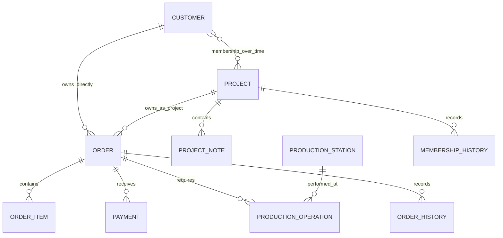

# Domain Model

## 1. Purpose and Modeling Boundary

This document describes the conceptual domain for the MetalCraft web
edition using confirmed business decisions and evidence from the legacy
WinForms application.

It is a conceptual model, not a database schema, class diagram, or final
implementation design. The target persistence model, aggregate
boundaries, and technology choices remain architectural decisions.

## 2. Core Concepts

### Customer

A customer represents an individual or organization that receives
services or places orders.

A customer:

- May own orders directly.
- May belong to zero, one, or multiple projects.
- May have both direct customer-owned orders and project-owned orders through project membership.
- May be archived and later reactivated using the same record and permanent code.
- May be physically deleted only when there are no orders, operational history, historical project memberships, or unresolved dependencies.

Customer names are not unique. The customer code is the permanent unique
business identifier.

Observed legacy fields include name, phone, secondary phone, company,
national identifier, and address. The complete target field catalogue
and validation rules remain open.

### Project

A project groups multiple customers for a shared body of work.

Confirmed rules:

- A project may have multiple customers.
- A customer may belong to multiple projects.
- A customer may appear only once as a current member of a given project.
- A project order belongs to the project as a whole, not to an individual member customer.
- A project may have multiple historical orders, but no more than one active order at a time.
- A project with no active orders may be archived.
- An archived project retains its orders, membership history, and permanent code, and can later be reactivated.
- A project may have internal notes with permission-controlled access and traceable changes.

Project names are not unique. The project code is the permanent unique
business identifier.

### Project Membership

Project membership represents a customer's participation in a project
over a period of time.

Membership is many-to-many over the lifetime of the domain:

- A customer may participate in multiple projects.
- A project may contain multiple customers.
- A customer may have only one current membership in a given project.
- Ending a membership does not erase its history.
- Rejoining creates a new membership period.
- Membership can change while a project has an active order.
- Removing a member does not alter or delete project-owned orders.
- A transfer ends the source membership and creates a destination membership; simultaneous membership in both projects is also allowed when intended.

The legacy database uses a many-to-many membership structure
(`ProjectCustomers`). The target model must preserve membership history;
the final persistence design remains open.

### Order

An order represents a commercial and operational request.

Confirmed ownership invariant:

- Every order has exactly one owner.
- The owner is either one Customer or one Project.
- An order must never be owned by both a Customer and a Project.
- An order must not exist without an owner.

Two ownership types are supported:

- Customer-owned order.
- Project-owned order.

A customer who belongs to a project may have both types. A project-owned
order belongs to the project as a whole; the requesting member customer
does not need to be recorded.

The confirmed order lifecycle rules apply to both ownership types. The
one-active-order constraint applies only to project-owned orders; no
equivalent customer-level limit has been approved.

### Order Lifecycle

For project-owned orders:

- All statuses other than `Completed` and `Cancelled` count as active.
- A project may receive a new order after its previous order is completed.
- A project may not receive another order while it has an active order.
- A cancelled project order may be reactivated only if no other active order exists for that project.

An order may be cancelled through the normal workflow only before the
first production operation starts. An order enters production when the
first production operation is recorded as started; order creation or
production planning alone does not count.

Production may be paused and resumed. A paused order remains active.
Pause requires a reason, and every pause/resume event must be retained
with timestamps and responsible users.

Completion requires both the appropriate permission and successful
completion of every required production operation.

The complete status catalogue and all transitions remain open.

### Order Changes and History

After production starts:

- Non-operational information, such as descriptions, may still be edited subject to permissions.
- Technical specifications may be changed only with a special permission and only if the related production operation has not started.
- A permitted technical change must record the previous value, new value, reason, timestamp, and responsible user.

### Order Item

An order item represents a line or item belonging to an order. The
inspected source includes item-level data and the Debug database
contains `Color` and `Brand` fields.

The complete item structure, quantity/unit rules, product/service
distinction, and pricing rules require further confirmation.

### Production Operation and Station

A production operation represents work required to fulfill an order. A
production station represents a work area or step in a production
process.

The first started production operation determines when an order has
entered production for cancellation and technical-edit rules.

The legacy application includes station records and order-station/route
data. Whether routes are fixed, configurable per order, or configurable
by product/order type remains open.

### Payment

Payment represents money received or recorded against an order. The
legacy source includes payment-related fields and status logic, but the
complete payment model and accounting rules have not been established.

### Project Note

A project note is internal information associated with a project, such
as operational context, agreements, or execution details.

Notes are visible only to internal users with the appropriate
permissions. Changes must be traceable. The exact note format,
attachments, and editing/versioning behavior remain open.

### User and Permission

A user represents an internal application account.

The System Administrator has administrative authority and can grant
specific permissions to other users. Permissions are granular and may be
independent; for example, create, edit, archive, and delete permissions
need not be bundled.

Confirmed permission-controlled actions include project-order creation,
production pause/resume, order completion, technical order changes, and
customer/project management actions.

The full role catalogue, permission catalogue, and authentication
requirements remain open.

## 3. Conceptual Relationships



The diagram expresses conceptual relationships only. It does not
prescribe table names, foreign-key strategy, aggregate boundaries, or
implementation cardinalities beyond confirmed business rules. Payment
and production relationships require further validation.

## 4. Order Ownership Invariant

```text
Customer-owned order:
    CustomerId is set
    ProjectId is null

Project-owned order:
    CustomerId is null
    ProjectId is set
```

Invalid states:

```text
CustomerId is null AND ProjectId is null
CustomerId is set  AND ProjectId is set
```

This invariant must be enforced in the web edition at the appropriate
domain and persistence boundaries.

## 5. Lifecycle and Integrity Constraints

The web edition must preserve the following invariants:

- At most one active project-owned order per project.
- `Completed` and `Cancelled` are the only statuses excluded from the active-order predicate.
- Reactivating a cancelled project order must not violate the active-order limit.
- A customer cannot have duplicate current membership in the same project.
- Membership history must survive removal and rejoining.
- Project deletion and dependent active-membership cleanup must be atomic when deletion is permitted.
- Permanent customer/project codes must not be changed or reused.
- Archived customers and projects cannot be used for new order creation until reactivated.
- Server-side authorization must protect all permission-controlled operations.

## 6. Legacy Implementation Notes

- Project membership is many-to-many in the legacy database.
- Project deletion is blocked by the legacy repository when any order
    exists for the project.
- The Debug database has an `IsActive` field on Projects, but the
    inspected project model/repository does not appear to use it
    consistently.
- No legacy persistence-level guarantee for one active order per
    project was found.

These are implementation observations, not automatically accepted domain
rules.

## 7. Open Modeling Questions

See `OPEN_QUESTIONS.md` for unresolved decisions concerning order status
transitions, cancellation consequences, customer/project fields,
production routing, pricing, payments, roles, reporting, and deployment.

The conceptual model must not be treated as a final schema or a
technology selection.
