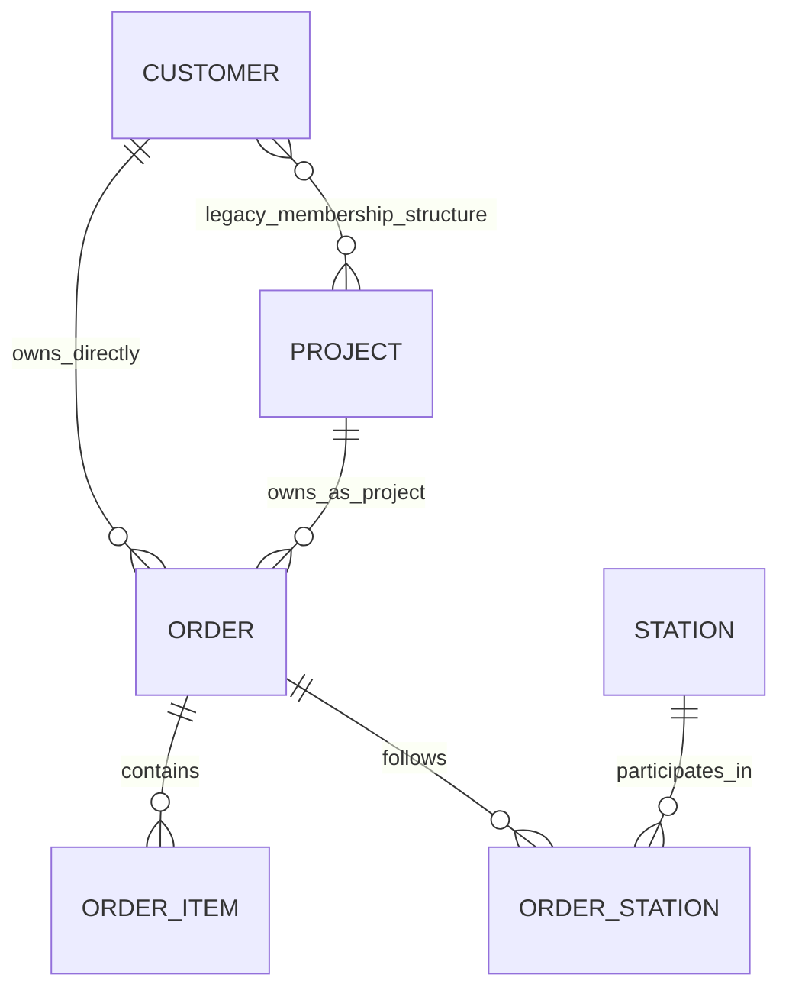

# Domain Model

## 1. Purpose and Modeling Boundary

This document describes the domain concepts evidenced by the existing MetalCraft application and the business rules already confirmed for the planned web edition.

It is a conceptual model, not a database schema, class diagram, or final implementation design. The target persistence model and aggregate boundaries remain architectural decisions.

## 2. Core Concepts

### Customer

A customer represents an individual or organization that receives services or places orders.

Observed legacy data includes fields such as name, phone, secondary phone, company, national identifier, and address. The exact required fields, validation rules, and uniqueness constraints for the web edition are not yet confirmed.

A customer may:
- Own an order directly.
- Be a member of a project.

The legacy database supports many-to-many project membership through the `ProjectCustomers` structure. Whether a customer may participate in multiple projects is a business rule that requires confirmation.

### Project

A project groups multiple customers for a shared body of work.

Confirmed rules:
- A project can have multiple customer members.
- Orders may be owned by the project itself.
- A project order belongs to the project as a whole, not to one of its member customers.

The legacy database uses a many-to-many membership structure (`ProjectCustomers`). This describes the legacy data structure; it does not, by itself, settle every project-membership policy for the web edition.

### Order

An order represents a commercial/operational request.

Confirmed ownership rule:
- Every order has exactly one owner.
- The owner is either one Customer or one Project.
- An order must never be owned by both a Customer and a Project.
- An order must not exist without an owner.

The legacy model includes customer and project ownership fields. The Debug database enforces exclusive ownership with a database constraint.

Order types observed in the legacy application include production and service. Order items and commercial/payment-related fields are also present.

### Order Item

An order item represents a line or item belonging to an order. The inspected source includes item-level data and the Debug database contains `Color` and `Brand` fields.

The complete item structure, quantity/unit rules, pricing rules, and whether items represent products, services, or both require confirmation. Whether and how order items are included in the web edition also requires product-owner confirmation.

### Production Station

A production station represents a step or work area in a production process.

The legacy application includes station records and order-station/route data. Whether routes are fixed, configurable per order, or configurable by product/order type remains open.

### Payment

Payment represents a payment-related financial event or record in the legacy domain. The exact business meaning, lifecycle, and association with orders, invoices, or other financial records have not been established.

The conceptual relationship between Order and Payment is intentionally left unspecified. The available legacy evidence does not establish the complete payment cardinality or lifecycle. In particular, whether an order can have multiple payments, whether partial payments or advances are supported, and whether payments belong to an order or an invoice must be confirmed before the web model is designed.

### User

A user represents an application account. The legacy application has user records and a login flow. Roles, permissions, account lifecycle, and security requirements for the web edition are not yet defined.

## 3. Conceptual Relationships



The diagram expresses conceptual relationships only. It does not prescribe table names, foreign-key strategy, aggregate boundaries, or final cardinalities beyond the confirmed order-ownership rule and the observed legacy membership structure.

The Customer–Project many-to-many relationship reflects the legacy database structure; the business policy for customer membership across projects remains to be confirmed. The Order–Payment relationship is intentionally omitted because its association and cardinality are not established. Production relationships also require further validation.

## 4. Order Ownership Invariant

An order has one and only one owner:

```text
Customer-owned order:
    CustomerId is set
    ProjectId is null

Project-owned order:
    CustomerId is null
    ProjectId is set
```

Invalid states:

```text
CustomerId is null AND ProjectId is null
CustomerId is set  AND ProjectId is set
```

This invariant must be enforced in the web edition at the appropriate domain and persistence boundaries.

The two ownership cases are mutually exclusive alternatives. They must not be modeled or implemented as two independent relationships that can both be set for the same order.

## 5. Project Order Lifecycle Constraint

Confirmed intent:
- A project may have multiple historical orders.
- At most one active, non-cancelled order per project is intended.

Still unresolved:
- Whether a new project order may be created after the previous order reaches `Completed`.
- Which exact statuses count as active.
- Whether a project order in a payment-pending or paused state blocks another order.
- Whether concurrent order creation must be protected by a database constraint.

Do not encode a filtered unique index or status predicate until the status definitions and lifecycle rule are approved.

## 6. Legacy Implementation Notes

- Project membership is many-to-many.
- Project deletion is blocked by the legacy repository when any order exists for the project.
- The Debug database has an `IsActive` field on Projects, but the inspected project model/repository does not appear to use it consistently.
- No legacy persistence-level guarantee for one active project order was found.

These are implementation observations, not automatically accepted domain rules.

## 7. Open Modeling Questions

See `OPEN_QUESTIONS.md` for unresolved decisions concerning customer identity, project membership, order lifecycle, payments, production routing, and user permissions.
