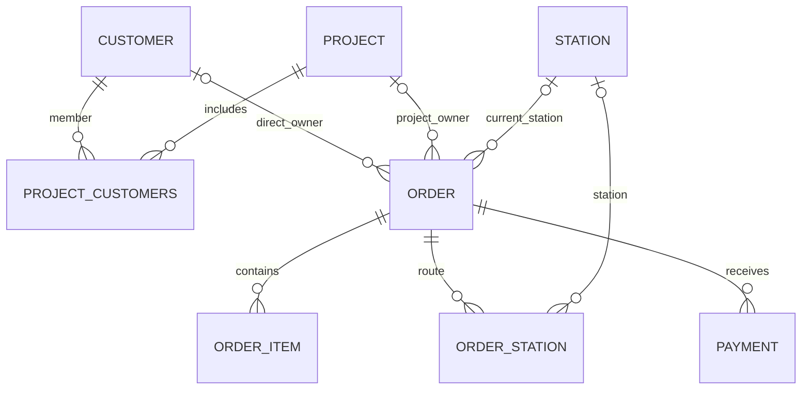

# مدل دامنه فعلی MetalCraftPro

## 1. موجودیت‌ها

### User
- `Id`
- `Username`
- `FullName`
- در `UserAccount`: `PasswordHash`, `Salt`, `CreatedAt`

نقش یا Permission در مدل فعلی دیده نمی‌شود.

### Customer
- `Id`, `Code`, `FullName`
- `Phone`, `Phone2`
- `Company`, `NationalId`
- `Address`, `Notes`, `CreatedAt`
- `OrderCount` به‌عنوان مقدار محاسباتی/نمایشی

### Project
- `Id`, `Code`, `Name`, `Description`, `CreatedAt`
- در دیتابیس Debug: `IsActive`

### Order
- `Id`, `OrderNumber`
- `CustomerId` nullable
- `ProjectId` nullable
- `Type`: `Production` یا `Service`
- `Status`: `PendingPayment`, `InProduction`, `Completed`, `Cancelled`
- `Description`
- `SubTotal`, `DiscountPercent`, `DiscountAmount`
- `TaxPercent`, `TaxAmount`, `PayableAmount`
- `PrepaymentPercent`, `PrepaymentAmount`, `PaidAmount`
- `CurrentStationId`
- `CreatedAt`, `ConfirmedAt`, `CompletedAt`
- `ProformaNumber`, `InvoiceNumber`

### OrderItem
- `Id`, `OrderId`
- `Title`, `Material`, `Thickness`
- `Quantity`, `Unit`, `UnitPrice`, `LineTotal`
- `Color`, `Brand`

### Station
- `Id`, `Name`, `Description`, `SortOrder`, `CreatedAt`

### OrderStation / RouteStep
- `Id`, `OrderId`, `StationId`
- `StationName` به‌عنوان Snapshot نام ایستگاه
- `Sequence`, `IsDone`, `DoneAt`, `Notes`

### Payment
- `Id`, `OrderId`, `Amount`, `Method`, `Reference`, `PaidAt`

### Settings
- `Key`, `Value`

## 2. روابط داده‌ای

- هر Order دقیقاً یکی از دو مالک را دارد: Customer یا Project.
- هر Customer می‌تواند سفارش مستقیم داشته باشد.
- هر Project می‌تواند چند Customer داشته باشد و هر Customer می‌تواند عضو چند Project باشد؛ جدول واسط `ProjectCustomers` این رابطه چندبه‌چند را مدل می‌کند.
- **قاعده کسب‌وکاری تأییدشده توسط مالک محصول: هر Project در هر زمان فقط یک سفارش فعال/جاری دارد.** اگر سفارش پروژه لغو شود، امکان ثبت سفارش جدید برای همان پروژه وجود دارد. سفارش پروژه‌ای متعلق به کل پروژه است و پروژه به‌عنوان یک واحد به خط تولید می‌رود؛ سفارش به مشتریان عضو تقسیم نمی‌شود.
- هر Order چند OrderItem دارد.
- هر Order چند OrderStation در مسیر تولید دارد.
- هر Order چند Payment دارد.
- هر Order در هر لحظه یک `CurrentStationId` اختیاری دارد.
- Station در OrderStation با `ON DELETE SET NULL` حذف‌پذیر است؛ `StationName` برای حفظ نام ثبت‌شده مرحله وجود دارد.

## 3. نمودار ساده روابط

## 4. قاعده مالکیت و تعداد سفارش پروژه

در سفارش مستقیم، `CustomerId` مقدار دارد و `ProjectId` تهی است. در سفارش پروژه‌ای، برعکس، `ProjectId` مقدار دارد و `CustomerId` تهی است.

مالک محصول تأیید کرده است:
- یک مشتری می‌تواند سفارش مستقیم داشته باشد و همان سفارش وارد خط تولید شود.
- چند مشتری می‌توانند عضو یک پروژه باشند.
- هر پروژه فقط **یک سفارش** دارد.
- سفارش پروژه‌ای متعلق به کل پروژه است و کل پروژه به‌عنوان یک واحد وارد خط تولید می‌شود.
- سفارش پروژه‌ای به مشتریان عضو تقسیم نمی‌شود و لازم نیست به یکی از اعضای پروژه نسبت داده شود.

**پیامد مدل‌سازی:** رابطه تاریخی Project به Order می‌تواند یک‌به‌چند باشد؛ اما برای هر پروژه حداکثر یک سفارش غیرلغوشده مجاز است. در دیتابیس مقصد می‌توان این قاعده را با Unique Filtered/Partial Index روی `ProjectId` برای Statusهای غیر از `Cancelled` تضمین کرد. این تصمیم، سفارش لغوشده را حفظ می‌کند و اجازه ثبت سفارش جایگزین را می‌دهد.

## 5. قواعد سازگاری داده

- دیتابیس Debug همراه آرشیو این مدل جدید را تا حد زیادی منعکس می‌کند.
- دیتابیس Release همراه آرشیو مدل قدیمی‌تر مشتری-محور دارد.
- در نتیجه این نمودار توصیف مدل مشاهده‌شده در کد جاری و دیتابیس Debug است، نه تضمین سازگاری همه فایل‌های دیتابیس همراه آرشیو.
