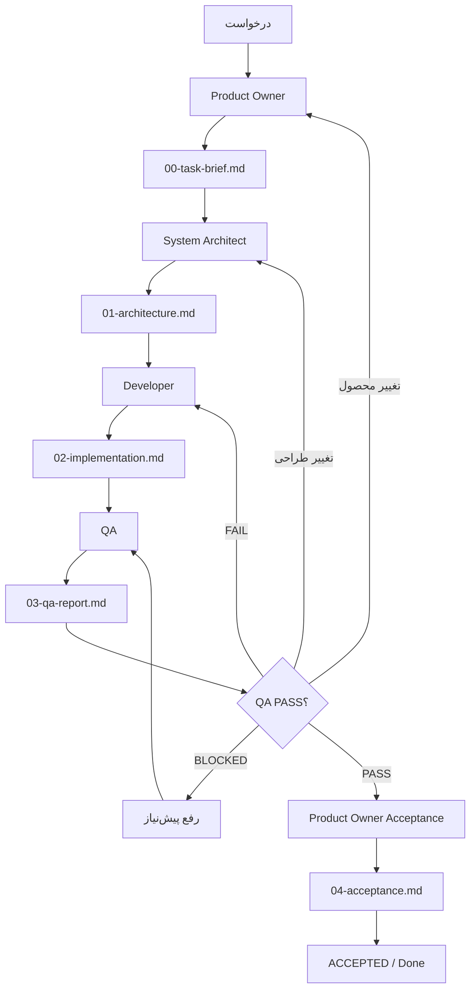

# MetalCraft — Atomic Task Development Workflow

## زنجیره اجباری

هر خروجی، ورودی رسمی اسکیل بعدی است. خلاصه چت جای فایل تحویلی را نمی‌گیرد.

## مراحل
1. **PO**: درخواست را به Task اتمیک تبدیل می‌کند و `00-task-brief.md` را می‌سازد. معیارهای Given/When/Then، Scope، قواعد، ریسک‌ها و موارد باز را تعیین می‌کند.
2. **Architect**: Brief و Repository واقعی را می‌خواند و `01-architecture.md` شامل نگاشت ACها، تغییرات فایل‌به‌فایل، قراردادها، داده/Migration، امنیت، تراکنش و Test Strategy می‌سازد.
3. **Developer**: فقط بر اساس دو سند قبل کدنویسی می‌کند و `02-implementation.md` با شواهد Build/Test و diff می‌سازد.
4. **QA**: مستقل تست می‌کند و `03-qa-report.md` با PASS/FAIL/BLOCKED می‌سازد.
5. **PO Acceptance**: در صورت QA PASS، `04-acceptance.md` را می‌سازد و Task را ACCEPTED می‌کند.

## مسیرها
`docs/workflow/tasks/<TASK-ID>/00-task-brief.md`
`docs/workflow/tasks/<TASK-ID>/01-architecture.md`
`docs/workflow/tasks/<TASK-ID>/02-implementation.md`
`docs/workflow/tasks/<TASK-ID>/03-qa-report.md`
`docs/workflow/tasks/<TASK-ID>/04-acceptance.md`

## حلقه بازخورد
- QA FAIL → Developer اصلاح → QA دوباره تست.
- اصلاح نیازمند تغییر طراحی → Architect بازنگری → Developer → QA.
- تغییر معیار/رفتار محصول → PO نسخه جدید Brief صادر کند؛ نسخه قبلی حفظ شود.
- QA BLOCKED → پیش‌نیاز رفع و سپس QA.
- هیچ مرحله‌ای نباید به‌صورت صوری یا صرفاً با اعلام متنی پاس شود.

## استقلال
اگر ابزار چند Agent ندارد، یک مدل می‌تواند نقش‌ها را در نوبت‌های جدا اجرا کند؛ اما در هر نوبت فقط Skill همان نقش را اجرا کند، خروجی را در فایل بنویسد و مرحله بعد همان فایل را بخواند. QA حق تغییر کد ندارد.

## Task index و Definition of Done
`docs/workflow/TASK_INDEX.md` برای همه Taskها وضعیت و مسیر اسناد را نگه می‌دارد.
Task فقط با Brief تأییدشده، Design آماده، گزارش پیاده‌سازی مستند، QA PASS و PO ACCEPTED تمام است.

## شروع هر Task
ابتدا فقط PO را اجرا کن؛ پس از تولید Brief و تأیید مالک محصول، Architect، Developer، QA و PO Acceptance به‌ترتیب اجرا شوند. Taskهای مستقل را با هم ادغام نکن.
